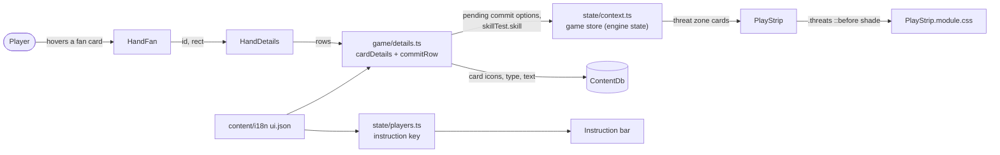

## Context

A skill test's commit window (`game.pending.kind === "commit"`) is answered from the hand fan: the committable cards rise, a tap commits one, and hovering a card shows its details column (`HandDetails`, rows built by `cardDetails()` in `src/ui/game/details.ts`). The column is the same as outside a test: class, cost, icons, rules text. The engine already decides what a committed card gives (`iconsFor` in `src/engine/rules/skillTest.ts`: the tested skill's icons plus wild) and labels each option "Commit X (+N)", but the UI never shows that label on a hand card and nothing says the card is not played. Skill cards are the exception the rules make: their text is their commit effect (Vicious Blow is data as an `onPlay` ability conditioned on the test), so the message must differ by card type.

On the desktop the viewer's engaged enemies and threat-area cards are a row at the top centre of the table (`.play-strip.threats` in `PlayStrip.module.css`, fixed under the top bar, over the map). The map's location cards show through behind them. The hand fan solves the same readability problem with a `::before` shade (`HandFan.module.css`): a vertical gradient masked at both ends.

In-force ADRs (0001 to 0016, none superseded) that bound this design: ADR-0004 (what is looked at is view state, what is decided is game state), ADR-0005 (one layout mode read by components), ADR-0016 (a component owns its styles in its CSS Module; other components are reached only through public hook classes). ADR-0002 is unaffected: nothing new animates.

Lightweight C4-inspired component sketch (one container, the browser app; plain Mermaid):

- The engine is the only source of what counts: the UI reads the pending commit options and the test's skill from the game store and computes the icon count from card data it already has.
- Nothing crosses a component boundary: the row lives in `details.ts` and renders in `HandDetails`; the shade lives in `PlayStrip`'s own module.
- The instruction bar change is text only, through the existing `instruction.commit` keys.

## Goals / Non-Goals

**Goals:**

- A player hovering a committable card during a commit window sees, before the card's text, what the card adds ("+N" with the icons) and whether its text applies.
- The commit instruction itself says the card's icons are what is added.
- The desktop threat row reads over any location behind it, with the same visual language as the hand fan's shade.

**Non-Goals:**

- Changing what a card contributes or the engine's option labels.
- The placed cards' "+N" on the skill-test screen (already there), the glance badge chips, the phone layout.
- Rewriting the "Play area strip" layout requirement (it still says the threats are a right-hand column; the open change `asset-area-stacks` keeps that wording). Flagged in Open Questions.
- Mind over Matter's stand-in skill: the row counts the tested skill's icons; the engine's label stays authoritative for that card.

## Decisions

1. **A `commit` detail row built in `details.ts`, not in the component.** `cardDetails()` already turns a card into typed rows and `blockedRow()` already adds a game-state row ("why it can't be played"). A sibling `commitRow(db, game, id, locale)` returns `{ k: "commit"; icons: IconName[]; n: number; note: string; textApplies: boolean } | null` when `game.pending?.kind === "commit"`, the pending options hold `value.commit === id` (the engine has already applied `canCommit`), and `game.skillTest` is live. `HandDetails` inserts it after the name row, as `blockedRow` is inserted today, and passes `dim` to the `text` row when `textApplies` is false. Alternative: compute in `HandDetails` from `useCardOptions`. Rejected: rows are tested as data in `details.test.ts` without React, and the blocked row sets the pattern.
2. **Icon count from card data, in the UI.** `n = icons[skill] + icons.wild` from `db.cards[code].icons` and `game.skillTest.skill`, the icons listed as the skill repeated `icons[skill]` times then `wild` repeated `icons.wild` times. This matches `iconsFor` except for Mind over Matter. Alternative: export `iconsFor` from `src/engine/api.ts` for the UI. Rejected for now: `api.ts` is what card scripts may import, not a UI surface, and `iconsFor` takes the engine's `G` context; the simple sum is right for every core card and the limit is written down in the row's doc comment.
3. **Text applies iff the card's type is `skill`.** The rules: a committed skill card's text is in effect; an asset or event committed for icons is not played. The note text is one of two i18n keys (`card.commit.icons`, `card.commit.skill`), the row label `card.commit`. The rules-text row gets an optional `dim` flag rendered as a muted colour (class in `HandDetails.module.css`), not removed: the player may still want to read it.
4. **Instruction wording changes in the two locales only.** `instruction.commit` and `instruction.commitOther` already receive `{skill}`; the English becomes "Tap a card to add its {skill} icons to the test, then Done" and the Russian its equivalent. The spec's Instruction bar scenario changes with it. No code.
5. **The shade is a `::before` on `.play-strip.threats`, in `PlayStrip.module.css`.** Same recipe as `HandFan.module.css`: `inset` negative on the sides and bottom, `z-index: -1`, a `linear-gradient(to bottom, …)` from about 0.88 to transparent, `mask-image` fading the left and right 90 px. Being a pseudo-element of the row it has no pointer events, slides with `.aside`, and does not exist when `PlayStrip` returns null for an empty row. The row keeps `overflow-x: auto`, which would clip a pseudo-element; the shade therefore goes on a wrapper or the row drops the clip in favour of the existing sideways scroll on its inner track. Decide at implementation; the spec only says the shade extends past the cards. Alternative: a separate shade element in `Hud.tsx`. Rejected: it would need its own visibility logic that the row already has.
6. **No engine change, no new state.** The row and the shade derive from engine state already in the store; nothing is added to the view store (ADR-0004).

## Risks / Trade-offs

- [The icon count disagrees with the engine under Mind over Matter] -> the engine's label and the placed card's "+N" stay authoritative; documented limit; a later change can export a UI-safe `commitIcons`.
- [The details column grows by two rows and pushes the text below the fold on short windows] -> the column is already clamped by `placeDetails`; the note is one line; the dimmed text is still there.
- [A card whose text applies when committed is not a skill card] -> none in the shipped core set; if a pack adds one, `textApplies` becomes a card-data flag. Noted in the row's comment.
- [The shade covers the map's top row of locations] -> it is as wide as the row plus the fade, only while the row has cards; the camera already keeps the feed and strip clear and the shade is translucent.
- [`overflow-x: auto` clips the pseudo-element] -> see decision 5; the implementation checks both desktop widths in the browser.

## Migration Plan

Pure UI change, deployed with the next build. Rollback is reverting the commit. The spec's modified requirements are synced at archive.

## Open Questions

- The "Play area strip" requirement describes the threats as a right-hand column; the code has had a top-centre row since 2026-10-15 and `asset-area-stacks` repeats the column wording. This change adds "Threat row shade" as a new requirement rather than rewriting the layout; a sync of the layout wording is a separate change.
- Whether `iconsFor` should become part of a UI-facing engine surface (not `api.ts`). Not needed for this change.
- No in-force ADR needs revisiting.
