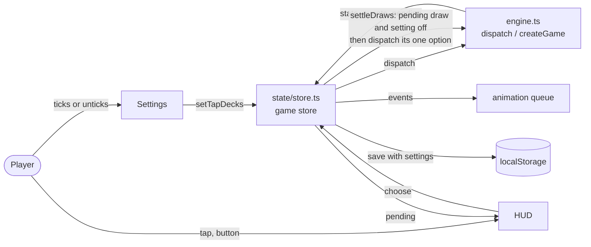

## Context

The engine waits before a draw in play only when the game's setup carries `tapDecks` (`tapToDraw` in `src/engine/core.ts`): it offers a pending `draw` choice with one option, and the cards leave the deck when it is chosen. The UI's `startScenario` (`src/ui/state/store.ts`) copies the "Tap decks to draw" setting into that setup once, so the setting is frozen for the scenario. Everything that shows the wait reads `game.pending.kind === "draw"`: the deck glow and the phone handle (`deckOptions` in `src/ui/state/players.ts`), the instruction bar, the choice spotlight, the table switch to the drawing investigator.

The phase pause shows how the UI already answers an engine choice by itself: `PhasePause` in `Hud.tsx` calls `choose("continue")` when its 3 s countdown ends, and the choice is recorded like a tap, so replays stay exact (ADR-0014, player windows are engine windows; the Undo requirement).

In-force ADRs (0001 to 0016, none superseded) that bound this design: ADR-0002 (presentation follows the event clock: the engine runs ahead, events queue), ADR-0004 (deciding is game state), ADR-0014 (player windows are engine windows: the wait is a recorded choice, not a UI pause).

Lightweight C4-inspired component sketch (one container, the browser app; plain Mermaid):

- The engine always asks; the store is the one place that decides whether the player or the UI answers.
- The HUD never sees a `draw` prompt while the setting is off, because the store answers it before publishing the state.
- The recorded action list is the same shape as a tapped game's.

## Goals / Non-Goals

**Goals:**

- The setting changes behaviour the moment it is changed, in a running game, both ways.
- With it off, no trace of the wait reaches the screen: no glow, no instruction, no button, no table switch.
- Saves, reports, replays and Undo behave as they do now.

**Non-Goals:**

- The encounter and weakness showcase's Continue, the phase countdown, the chaos token draw, the bot.
- Changing the engine: `tapToDraw`, its tests and the `game-engine` spec stay.
- Games whose setup never asked for tapped decks (old saves, imported logs): they keep drawing without a choice.

## Decisions

1. **The engine always asks; the UI answers when the setting is off.** `startScenario` passes `tapDecks: true` unconditionally. Alternative: keep passing the setting into the setup and add an engine action "set tapped decks". Rejected: the setup would no longer describe the game (ADR-0014 and the Undo requirement want the game to be its setup plus its choices), and an untapped game could still not be made to wait. With the engine always asking, the choice list of an "off" game is the same as a tapped one with every draw answered at once, which the engine spec already defines.
2. **A store step, `settleDraws()`, not a component timer.** After any dispatch that can leave a pending choice (`choose`, `startScenario`, a save restored, a report loaded, `undo` for completeness) and on `setTapDecks(false)`, the store loops: while `game.pending?.kind === "draw"` and `tapDecks` is off, dispatch `{ type: "choose", inv: pending.inv, option: pending.options[0].id }`, append the action, the log mark and the events, and move `undoFloor` as `choose` does when hidden information is revealed. It runs inside the same `set` as the dispatch that produced the prompt, so no render sees the prompt (no glow, no bar, no table switch, no hand-off). Alternative: a `useEffect` in `Hud` like `PhasePause`. Rejected: a frame would show the wait and the table could switch investigators for nothing; and the phase pause's timer is the point of that component, there is no delay here.
3. **It bypasses `choose()`'s input gate.** `choose` refuses input while events animate, the intro plays or the showcase holds a card: those gates protect the player from acting on a table that is behind the engine. The automatic answer is not input; the engine running ahead of the screen is the normal state (ADR-0002), and the draw's events queue after the ones already waiting, so a mythos draw for the second investigator queues behind the first investigator's card in the showcase. `settleDraws` therefore calls `dispatch` directly and uses the same bookkeeping as `choose`, factored into one helper both use.
4. **A loaded save or report settles too.** A save made with the setting on may hold a waiting draw; loaded with the setting off it draws on load. A replay of recorded actions needs nothing: the actions include the draws.
5. **Undo needs no special case.** Undo never lands on a `draw` prompt (its only answer is the draw itself, which reveals hidden information and moves the floor). With the setting off the draw follows its cause within the same update, so the floor moves at once; this is the same as an untapped game today.
6. **Setting text stays; a hint is added.** `menu.tapDecks` keeps its label; `menu.tapDecks.hint` under the checkbox, rendered like the pace hint (`small`, `aria-describedby`).

## Risks / Trade-offs

- [Settling runs while the showcase holds a card, so a second mythos draw happens behind the showcase] -> that is the event clock's normal order; the second card's reveal queues after the first's; verified by a store test with two investigators in the mythos phase.
- [A draw prompt for another investigator used to switch the table to them; now nothing switches] -> intended; the next real decision still switches and hands off as today.
- [The "off" game records more actions than before (the draws)] -> same as every tapped game today; saves and reports already hold them.
- [An engine change later adds a `draw` prompt with more than one option] -> `settleDraws` answers only a prompt with exactly one option and otherwise leaves it to the player; a test pins this.

## Migration Plan

Pure UI change. A running game saved before this change whose setup has no `tapDecks` keeps drawing without a choice; one whose setup has it behaves as the setting says from the next draw. Rollback is reverting the commit; saves made with it replay under the old build (their actions are ordinary draw choices).

## Open Questions

- None. No in-force ADR needs revisiting.
