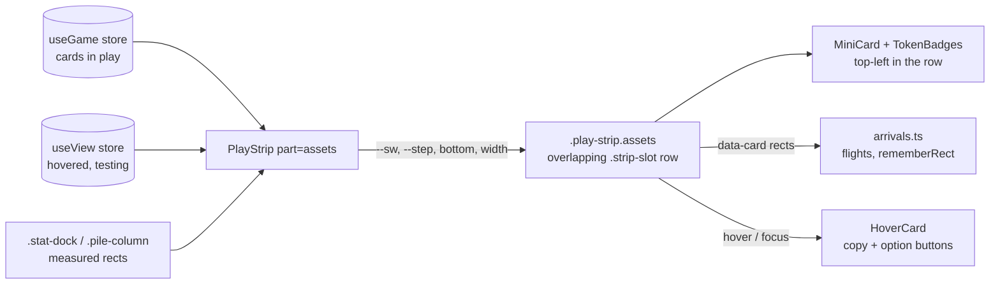

## Context

`PlayStrip` (`src/ui/hud/Panels.tsx`) renders the viewer's cards in play. On the desktop it is mounted twice: `part="threats"` is the column on the right, `part="assets"` the row at the bottom left. The row measures the stat dock and the pile column in a layout effect, sets its own `bottom`, `width` and `maxHeight`, and picks a card width with `rowCardWidth` so every card lies flat; the CSS wraps the cards (`flex-wrap: wrap`) and scrolls them (`overflow-y: auto`, inherited from `.play-strip`). With five or more assets the row wraps, shrinks the cards to 56 px and then shows a scrollbar.

Each card is a `.strip-slot` holding a `MiniCard` (`data-card`), which HoverCard, `arrivals.ts` (flights, `rememberRect`) and the tests find by selector. `TokenBadges` is positioned at the card's top-right by `.mini-card .tokens`.

In-force ADRs that bound this design (none superseded): ADR-0002 (presentation follows the animation clock), ADR-0004 (view state in the view store, game state in the engine), ADR-0005 (one layout mode read by components, not per-component media queries). The design keeps all three: nothing new is animated off the event clock, hover stays in the view store, and the phone/desktop split stays the `useLayoutMode()` read `PlayStrip` already makes.

Lightweight C4-inspired component sketch of the one container involved (the browser HUD); plain Mermaid:

## Goals / Non-Goals

**Goals:**

- The asset row never shows a scrollbar and never wraps, at any count of assets and at the supported desktop heights (900 and 768).
- Asset cards keep the threat column's full size (92 px).
- Every card's left edge and token badges stay readable in the overlapped row; the hovered or focused card comes forward.
- Flights, remembered rects, HoverCard buttons and the skill-test `aside`/`compact` modes keep working without change.

**Non-Goals:**

- No change to the threat column, the phone column, the piles, or the stat dock.
- No stacking by card kind and no attachment stacking (nothing in the core set attaches to an investigator's assets).
- No wider row over the table; the row stays the stat dock's width.
- No new card art, sizes or i18n strings.

## Decisions

**1. Overlap by a computed step, laid out with negative margins.** The row stays a flex row with `flex-wrap: nowrap`. `PlayStrip` computes the step (how far each card's left edge is from the previous one) in the existing layout effect: `step = min(cardW + gap, (rowW - lastW) / (n - 1))`, where widths count an exhausted card as 1.4× (it lies sideways). Each slot after the first gets `margin-left: step - prevW` (negative once they overlap) through one CSS variable `--step` and the slot's own width. Alternative considered: absolute positioning of every slot with a computed `left`. Rejected because flex keeps the slots' order, `rememberRect` and the fly-in selectors unchanged, and sizes exhausted cards without more code. Alternative: CSS alone (`flex-shrink` on fixed-width slots) can't produce a true overlap, only clipped cards.

**2. One pure function, tested.** `rowStep(rowW, widths[])` replaces `rowCardWidth` and `ROW_MIN_W` in `Panels.tsx`, with `strip.test.ts` cases for: fewer cards than fit (step = card + gap), exactly fitting, many cards, exhausted cards in the mix, and one card. The layout effect only applies it.

**3. Hover and focus bring a card forward with CSS.** `.strip-slot:hover`, `.strip-slot:focus-within` and the slot whose card is `useView.hovered` (HoverCard's peek on touch) get a higher `z-index`; the base `z-index` of the slots follows document order, so later cards lie over earlier ones. No layout shift of the neighbours: the big copy is the reading aid, and shifting neighbours would move the rects flights rely on mid-hover. Alternative considered: parting the neighbours like the hand fan; rejected for that reason and because the fan's Dock frame loop is far more code than the row warrants.

**4. Token badges top-left in the row only.** `.play-strip.assets .mini-card .tokens { left: -6px; right: auto }`. The `IntentBadge` is also top-left but appears only on enemies, which never sit in the row. Alternative: overlapping the other way (first card on top) keeps badges top-right but hides the cost and skill icons that tell cards apart; rejected in the interview.

**5. No `overflow` on the row.** `.play-strip.assets` sets `overflow: visible` so the badges that hang off a card's top-left corner and the pulsing ring are not clipped, and so no scrollbar can appear. The `maxHeight` measurement in the layout effect is dropped; the row's height is one card (`1.4 × 92` px), which fits under the piles at both desktop heights (at ≤ 860 px high the pile column already becomes a single row to make that room).

## Risks / Trade-offs

- [Eight or more assets overlap down to ~30 px per card on a 320 px row] -> the hover copy and the top-left badges still identify each; the hand fan already works this way. Measured: 8 cards at 92 px over 320 px gives a 32 px step.
- [A slot's margin changes while a card is flying in] -> flights read rects after layout (`rememberRect` in the same effect); the `left 0.3s` transition that `.fan-card` has is not applied to slots, so a changed step snaps, as the wrap did before.
- [HoverCard's copy is centred on the card and may run past the window's left edge for the first card] -> unchanged from today; HoverCard already keeps copies inside the window.
- [Keyboard users tab through overlapped cards] -> `focus-within` brings the focused slot forward; the order is document order, left to right.

## Migration Plan

Pure UI change, shipped with the next deploy. Rollback is a revert of the two files. The delta spec replaces the "Play area strip" requirement at archive time.

## Open Questions

None. No in-force ADR needs revisiting.
