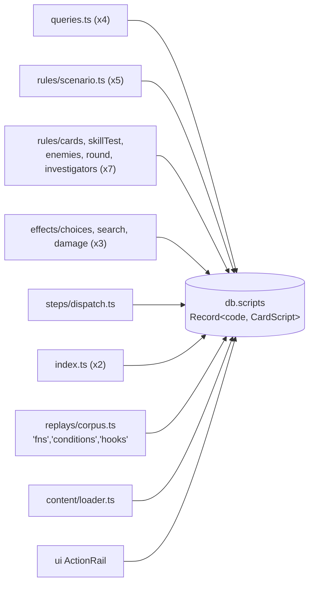
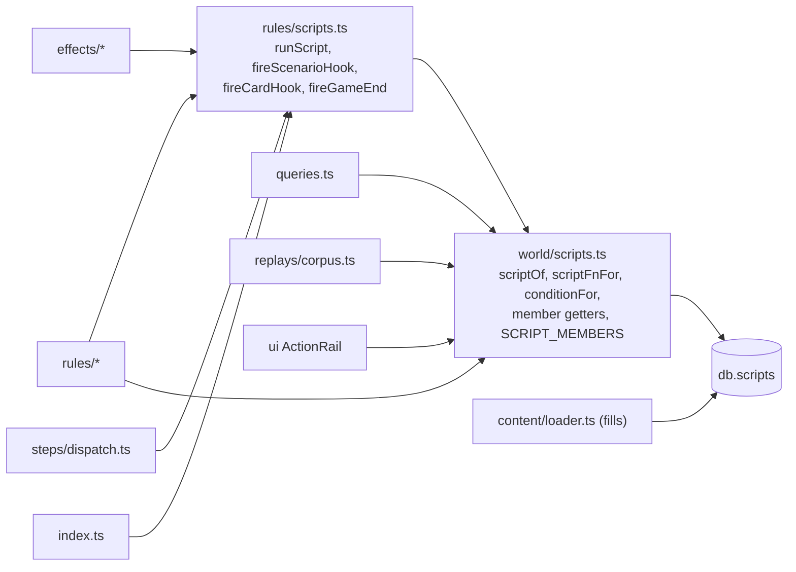

## Context

`ContentDb.scripts` (`world/types.ts`) holds every loaded script, keyed by card code, investigator code or scenario id, filled by `src/content/loader.ts:285`. A `CardScript` has function members (`icons`, `modifiers`, `extraPlayable`, `blanks`, `extraActionCost`, `wouldPlaceDoom`), maps of functions (`fns`, `conditions`, `hooks`) and data (`abilities`). After `engine-script-run-adapter`, `fns` are `(game, run)` and run only through `runScript` in `rules/scripts.ts`; `hooks` still have the old `(game, ctx, extra?)` shape.

Today's lookups, by kind:

| Kind | Sites |
| --- | --- |
| `fns` (card, else scenario) | `steps/dispatch.ts:90` (`??`), `effects/choices.ts:73` (picks the code at push time), `rules/skillTest.ts:476` (card only), `index.ts:184` (scenario only) |
| `conditions` (card, else scenario) | `queries.ts:502` |
| scenario hooks | `rules/scenario.ts:277,285,296` (`checkObjectives`, `ended`, `allEliminated`), `rules/enemies.ts:98` (`spawnRedirect`) |
| card hooks | `rules/scenario.ts:289` and `rules/investigators.ts:383` (`gameEnd`), `rules/cards.ts:660` (`eventFinished`), `effects/damage.ts:36` (`healHorror`), `effects/search.ts:28` (`searched`, presence only), `index.ts:267` (investigator `setup`) |
| members | `queries.ts:209,225,242` (`blanks`, `abilities`, `modifiers`), `rules/skillTest.ts:172` (`icons`), `rules/cards.ts:279` (`extraPlayable`), `rules/round.ts:199` (`extraActionCost`), `rules/scenario.ts:132` (`wouldPlaceDoom`) |
| outside the rules | `replays/corpus.ts:41` (member names as strings), `src/content/loader.ts:320` (card, else any scenario), `src/ui/hud/ActionRail/ActionRail.tsx:122` (`abilities`) |

The two `gameEnd` sites are not duplicates: one fires for every card in play, threat area or hand at the scenario's resolution, the other for an eliminated investigator's weaknesses before they leave the game. They share the hook and the ctx shape. Constraints: ADR-0021 to ADR-0026 in force; only `world/`, the core files, `index.ts`, `steps/dispatch.ts` and `rules/skillTest.ts` read `game.s` (ADR-0022, `openspec/specs/game-engine/spec.md`); the layer test (ADR-0025) ranks `world/` 0, `context` 1, `queries` 2, `rules/` 3, `effects/` 4, `steps/dispatch` 5, `index` 6.

## Goals / Non-Goals

**Goals:**

- One module reads `db.scripts`; one function states "card, else scenario".
- Every hook name and signature typed; no out-parameters.
- Script functions and hooks called only through `rules/scripts.ts`.
- The corpus and the `unrun.ts` list unchanged.

**Non-Goals:**

- The script run itself (done by `engine-script-run-adapter`), the API surface (`engine-script-verbs`).
- How scripts are loaded (`src/content/loader.ts` keeps filling `db.scripts`).
- Splitting `CardScript` by kind (open question).

## Decisions

### 1. Modules before and after

Lightweight C4-inspired component view of the engine container, plain Mermaid. Before (arrows are direct reads of `db.scripts`):



After:



- `world/scripts.ts` (layer 0) holds lookups only: it calls nothing. Every module that needs a member reaches it, including `queries.ts` (layer 2), which needs conditions, blanks and modifiers.
- `rules/scripts.ts` (layer 3) is the only caller of `fns` and `hooks`. Every hook site is in `rules/`, `effects/`, `index.ts` or above, so no site has to move.
- Rejected: one registry module that also calls (it would need `ask` and the run, layer 1+, so `queries.ts`'s conditions couldn't reach it without the layer test bending); a registry object built at load time (a second copy of `db.scripts` to keep in step for no gain: a lookup is one property read).
- Assumptions: no code outside `src/` reads `db.scripts` except tests and `scripts/` tools; the loader keeps owning the record's shape.

### 2. One fallback rule

`scriptFnFor(game, code, fn)` returns `{ code, fn }` for the card's own function, else the current scenario's (`game.s.scenarioId`), else `undefined`; `conditionFor(game, code, name)` the same for conditions. `effects/choices.ts` keeps choosing the code when it pushes the step (so the pushed step, which may sit in a pending choice in a snapshot, is unchanged) but asks `scriptFnFor`. `runScript` resolves the same way, and throws as today when neither has the function. The loader's static check calls `scriptFnIn(db, code, fn, scenarioIds)`, the same rule over every scenario, since at load time no scenario is current (open question 4).

### 3. Typed hooks

```ts
interface HookRun { readonly you: InvId; readonly source: InstId; readonly ctx: EffCtx }
interface ScriptHooks {
  setup(game, run: HookRun): void;                       // investigator: before the deck is shuffled
  checkObjectives(game): void;                           // scenario
  ended(game, won: boolean): void;                       // scenario, after endScenario; today { x: 0 | 1 }
  allEliminated(game): void;                             // scenario; default: resolution "none"
  spawnRedirect(game, enemy: InstId): InstId | null;     // scenario; today sets ctx.location
  gameEnd(game, run: HookRun): void;                     // card
  eventFinished(game, run: HookRun, event: InstId): void; // card
  healHorror(game, run: HookRun, target: InstId, n: number): number; // card; today lowers req.n
}
// on CardScript: hooks?: Partial<ScriptHooks>; cancelsSearch?: true   (was hooks.searched)
```

`fireScenarioHook(game, name, ...args)` and `fireCardHook(game, cardId, name, ...args)` are typed by `ScriptHooks[name]`. `fireGameEnd(game, cards)` is the one place "when the game ends" abilities fire; the resolution and the elimination each pass their filtered cards. Rejected: keep `Record<string, ScriptFn>` and validate names at load (a runtime error instead of a compile error); split hooks by owner kind now (open question 1).

### 4. Nothing else reads the scripts

`boundary.test.ts` gains a test: outside `world/scripts.ts`, `src/content/loader.ts` and tests, no source under `src/`, `content/` or `scripts/` contains `db.scripts` (the same text scan the store-records test uses). `traceScripts` in `replays/corpus.ts` walks `SCRIPT_MEMBERS`, a list in the registry checked against `keyof CardScript` with `satisfies`, so a new function member can't be missed by the unrun list.

## Risks / Trade-offs

- [A hook rewritten to return its result behaves differently when it returns nothing (`spawnRedirect` for other enemies)] -> `undefined`/`null` means "no redirect", exactly as an unset `ctx.location` did; the corpus has Midnight Masks recordings.
- [`healHorror` order: several cards lowering the same heal in turn] -> `fireCardHook` threads `n` through the cards in the same `allCards` order.
- [The registry's `game.s.scenarioId` read vs `scenarioIdOf`] -> the registry is in `world/`, where the read is allowed; `scenarioIdOf` stays for everyone else.
- [`traceScripts` wraps members on the loaded objects; the registry must read members at call time, not cache them] -> lookups read `db.scripts` on every call; the corpus test's unrun list proves the tracer still sees every run.

## Migration Plan

Registry with tests; lookups moved kind by kind (members, conditions, `fns`), corpus after each; hook types and the hook rewrites in content with their call sites, corpus after; boundary test last, when it passes. Rollback is reverting. No state or version change (`ENGINE_VERSION` stays 7).

## Open Questions

- The four in the proposal.
- In-force ADRs reviewed: ADR-0001 to ADR-0026 (ADR-0019 superseded in part by ADR-0020) and the proposed ADR-0027 from `engine-script-run-adapter`; none needs revisiting. ADR-0022's list of modules that read `game.s` is respected by putting the registry in `world/`.
