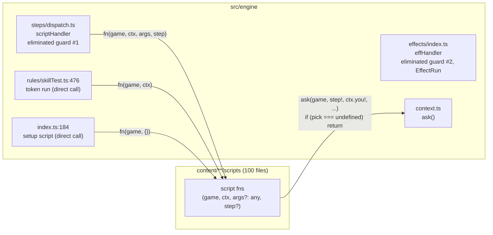
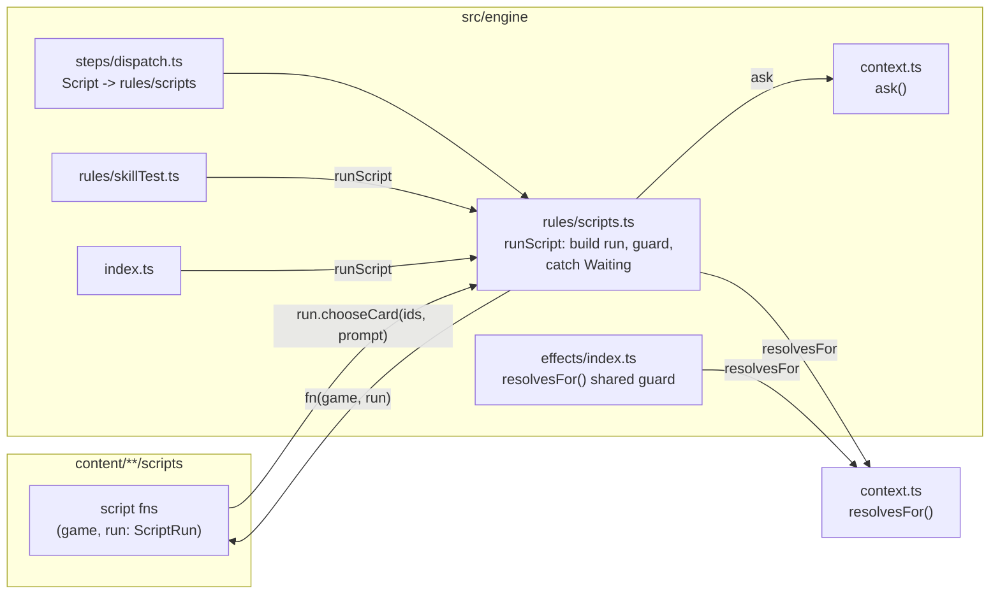

## Context

Two kinds of content code run inside the resolution stack. Data effects (`cards.json`) run through `effHandler` (`src/engine/effects/index.ts:68`), which returns early once the scenario has ended, skips an eliminated investigator, resolves `you` (context investigator, else the lead) and `src`, and hands each handler an `EffectRun`. Script functions (`fns` in `content/**/scripts/*.ts`) run through `scriptHandler` (`src/engine/steps/dispatch.ts:81`), which skips an eliminated investigator, finds the function (card's own, else the scenario's) and calls `fn(game, step.ctx, step.args, step)`. Two more callers skip the handler: a chaos token's `run` (`rules/skillTest.ts:476`, with `{ ...ctx, source }` and no step) and the scenario setup step `script` (`index.ts:184`, with `{}` and no step).

A script that needs a choice calls `ask` (`context.ts:380`): if the step already holds a choice it returns it; with `auto` and one option it returns that; otherwise it sets `state.pending` with a copy of the step and returns `undefined`, and the script returns. When the player chooses, the same step runs again from the top with `choice` set. So code before an `ask` must not change the state, and code after it is guarded. Two choices in one script are made by pushing a second `Script` step whose `args` carry what the first chose.

Measured over the 100 script files: 109 `ctx.you!`, 42 `ctx.source!` (74 reads of `ctx.source` in all), 48 `step!`, 34 `_args: unknown`, 36 guards after an `ask`, 49 `ask` calls (35 with `auto: true`), 26 copies of the card option map. Constraints: ADR-0021 to ADR-0026 are in force; scripts import only `src/engine/api.ts` (oxlint); modules import only lower layers (`src/engine/__tests__/boundary.test.ts`, ADR-0025); the replay oracle (`src/engine/replays/`, 71 recordings) compares each recording's final snapshot, pending choice included, and its event log.

## Goals / Non-Goals

**Goals:**

- A script function receives `(game, run)`, with `you` and `step` always set and `args: unknown`.
- One adapter builds the run, owns re-entry after a choice, the auto-pick and the eliminated guard, and is the only caller of a script function.
- No `any` in the script types; no non-null assertions needed for the run's fields.
- The corpus replays unchanged; the state's shape doesn't change.

**Non-Goals:**

- Hooks, conditions and the other `CardScript` members, and where scripts are looked up (`engine-script-registry`).
- What `api.ts` exports and the step literals scripts push (`engine-script-verbs`).
- Typing a script's own continuation arguments (`engine-typed-continuations`).
- The `__engine` functions in `steps/dispatch.ts`.

## Decisions

### 1. Modules before and after

Lightweight C4-inspired component view inside the engine (one container: the browser bundle's engine), plain Mermaid. Before:



After:



- The adapter is a `rules/` slice (`rules/scripts.ts`, layer 3): `rules/skillTest.ts` (same layer), `steps/dispatch.ts` (5) and `index.ts` (6) may import it; it imports `context.ts` and `world/`. No new layer, and the boundary test needs no change.
- The shared guard lives in `context.ts` (layer 1), so both `effects/` and `rules/` reach it.
- Assumptions: the engine runs in one JS realm (browser or Node test), so a thrown signal can't cross a boundary it shouldn't; nothing outside `rules/scripts.ts` catches errors around a script call today.

### 2. The run

```ts
interface ScriptRun {
  readonly you: InvId; // ctx.you ?? lead
  readonly source: InstId; // throws MissingSource(code.fn) when ctx.source is unset
  readonly step: Step; // the Script step, or a synthetic Script step for the token and setup callers
  readonly ctx: EffCtx; // enemy, location, card, key, x, token, ...
  readonly args: unknown;
  chooseCard(ids, prompt, opts?): InstId;
  chooseInvestigator(invs, prompt, opts?): InvId;
  choose<T>(options, prompt, opts?): T;
}
```

`prompt` is `{ text, key, vars? }`, the same English text and i18n key the `ask` call passes today, so the pending choice in the state is identical. `opts` carries `auto` (default true), `kind` (default `CHOICE.Target`), `who` (default `you`) and `shown`.

The token and setup callers have no step. They get a synthetic `Script` step (`{ t: STEP.Script, code, fn, ctx }`), never pushed; a choice verb called from them throws, as `ask` with no step would crash today (no such script asks). Rejected: making `step` optional on the run (the 48 `step!` would come back).

`source` throws on read rather than being `InstId | null`: 42 of the 74 reads assert it, so a missing source is a bug in the data that queued the script, and the error names it. Rejected: separate run types for card scripts and scenario scripts (the registry decides which script a function comes from only at run time; revisit in `engine-script-registry`).

### 3. Re-entry

A choice verb calls `ask`. With a value it returns it; when `ask` sets the pending choice, the verb throws a private `Waiting` signal (a module-local class in `rules/scripts.ts`) and `runScript` catches only that and returns. The step runs again when the choice arrives, as today, so the rule "change nothing before the first choice" still holds, and the adapter's tests state it. The 36 guards are deleted.

Alternatives: keep `T | undefined` and the guard (the protocol stays in 36 places); generator scripts that `yield` a choice (the same re-run on resume, since the stack is plain JSON and a generator can't be saved, and every script becomes a generator). Throwing is a new pattern in the engine, so it is open question 1.

### 4. Auto-pick

Verbs auto-pick a single option by default. The 14 `ask` calls without `auto: true` become verbs with `{ auto: false }`, so the recordings' choices and `seq` numbers don't move. The oracle catches a slip: a missing recorded choice shifts every later `seq`.

### 5. One eliminated guard

`resolvesFor(game, ctx)` in `context.ts`: false when `ctx.you` names an investigator whose status isn't `playing`. `effHandler` and `runScript` both call it. `effHandler`'s extra "scenario ended" return stays where it is: scripts never had it, and adding it could change a recording.

### 6. Migration

A one-off codemod (TypeScript compiler API, run from the scratchpad, not committed) rewrites each `fns` member's parameters to `(game, run: ScriptRun)` and `ctx.you!`→`run.you`, `ctx.source!`→`run.source`, `step!`→`run.step`, `args`→`run.args`, `ctx.<other>`→`run.ctx.<other>`. Old `ask(game, run.step, run.you, …)` calls still compile. Then each folder's `ask` calls become verbs by hand, guard by guard. The corpus is replayed after the codemod and after each folder.

## Risks / Trade-offs

- [Code before a choice that changes state now looks safe because there is no guard] -> the adapter's doc and a test state that the step reruns; the corpus covers the scripts that ask (`unrun.ts` lists those it doesn't).
- [A `try/catch` in a script swallowing `Waiting`] -> `Waiting` is not exported; a lint search for `catch` in `content/**/scripts` finds none today, and the adapter test fails if a waiting script's pending choice is missing.
- [The pending choice's `step` copy differs (the snapshot holds it)] -> the verbs pass the same step object to `ask`; the run never adds fields to it.
- [Codemod misses an unusual signature (six scripts type `args` themselves: `InstId[]`, `{ enemy?: InstId }`…)] -> those are narrowed by hand with a type guard; `pnpm typecheck` refuses `unknown` passed on unnarrowed.

## Migration Plan

Adapter and run with tests first; Script step, token and setup callers onto it; codemod; folder by folder to the verbs (`core`, `core_2026`, `nat`, `tcu`, `night-of-the-zealot`, `brethren-of-ash`), corpus replayed after each. Rollback is reverting the change; no save or version changes (`ENGINE_VERSION` stays 7, since the state's JSON is the same).

## Open Questions

- The four in the proposal (the throw, `source` typing, auto-pick default, one change or two).
- In-force ADRs reviewed: ADR-0001 to ADR-0026 (ADR-0019 superseded in part by ADR-0020); directly relevant ADR-0007 and ADR-0011 (behaviour as data, scripts for the rest), ADR-0013 (coverage), ADR-0018 and ADR-0020 (online play replays a move log), ADR-0021 to ADR-0026. None needs revisiting: this changes what a script receives, not when one is used. ADR-0030 and ADR-0032 (proposed by UI changes in flight) don't touch the engine.
