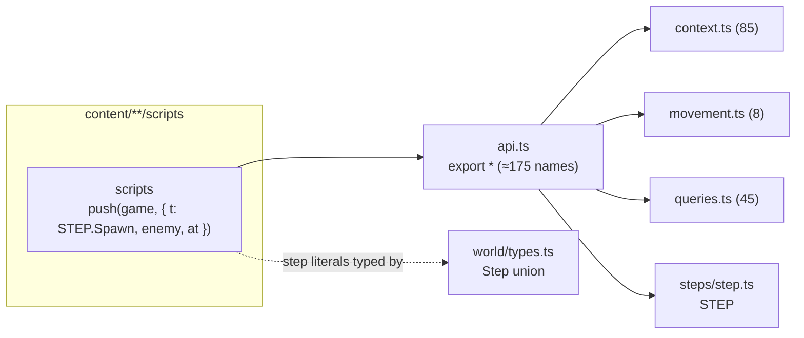
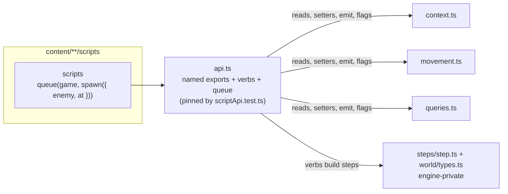

## Context

`src/engine/api.ts` re-exports `context.ts`, `movement.ts`, `queries.ts`, `events/event.ts`, `steps/step.ts` and `world/constants.ts` with `export *`, the `flags` namespace, and about 20 named exports from `rules/` and `world/`. Only `content/**/scripts` imports it (oxlint also stops scripts reading `game.s`). The 100 script files import 90 distinct names; the most used are `CardScript` (99), `GameContext` (98), `EffCtx` (76), `push` (63), `STEP` (62), `inv` (47), `def` (46), `EVENT` (40), `emit` (38), `Step` (37), `ask` (36), `CHOICE` (36). After `engine-script-run-adapter`, `EffCtx`, `Step` and `ask(game, step, …)` are replaced by the run; after `engine-script-registry`, `runScript` has one lookup rule.

`push(game, ...steps)` (`context.ts:371`) pushes in reverse so the first argument resolves first; two `push` calls resolve last-call-first. 8 script `push` calls queue several steps at once. Scripts write 127 step literals over 20 kinds. The progress fields engine handlers set on steps (`windowed`, `assigned`, `fired`, `asked`, `paid`) appear in no script; what ties content to the step types is their required fields and their names.

`src/engine/__tests__/scriptApi.test.ts` (76 lines) checks what scripts read about the scenario and a few setters. Constraints: ADR-0021 to ADR-0026, ADR-0027 and ADR-0028 (proposed); the boundary test ranks `api` at layer 7, so it may import any engine module.

## Goals / Non-Goals

**Goals:**

- `api.ts` names every export; the runtime list is pinned by a test.
- Scripts queue every engine step through a verb; the step union, `STEP` and `push` leave the script surface.
- Exactly today's stack order; the corpus replays unchanged.

**Non-Goals:**

- Splitting `context.ts` or moving functions between engine modules.
- New step kinds or new behaviour; verbs for kinds no script queues.
- Typing continuation arguments (`engine-typed-continuations`).

## Decisions

### 1. Modules before and after

Lightweight C4-inspired component view of the engine container, plain Mermaid. Before:



After:



- `api.ts` stays the one entry; nothing below it changes.
- Assumption: no script reads a `Step` value except through its run (true after `engine-script-run-adapter`).

### 2. Verbs build, `queue` pushes

```ts
declare const queued: unique symbol;
export type Queued = { readonly [queued]: true };        // opaque to scripts
export const spawn = (a: { enemy: InstId; at?: InstId | null; inv?: InvId | null }): Queued => …;
export const dealDamage = (a: { inv: InvId; damage?: number; horror?: number; source: InstId | null;
  direct?: boolean; enemy?: InstId | null }): Queued => …;
export const queue = (game: GameContext, ...steps: Queued[]) => push(game, ...(steps as unknown as Step[]));
```

Each verb fills defaults the literals spell out today (`direct: false`, `damage: 0`), so each rewritten call builds a step deep-equal to the literal it replaces, and pending choices and snapshots are identical. `push(game, A, B)` becomes `queue(game, a, b)` and two `push` calls become two `queue` calls, so every order is kept. Rejected: verbs that push at once (`dealDamage(game, …)`), which read naturally but resolve last-call-first, a trap for every script that queues two things (open question 1); verbs on the run (open question 2).

Verbs and the kinds they build: `runScript` (Script), `spawn`, `dealDamage` (AssignDamage), `resolveEffects` (Effects), `resolveEffect` (Eff), `advanceAct`, `placeDoom`, `endScenario` (Resolution), `drawCards` (Draw), `checkDoom`, `resolveRevelation` (Revelation), `enemyAttacks` (EnemyAttack), `discoverClues`, `damageEnemy`, `defeatInvestigator` (Defeated), `playCard`, `useAbility`, `moveInvestigator` (Move), `defeatEnemy`, `checkObjectives`.

### 3. The explicit list

`api.ts` lists its exports in groups (types; reads; setters and movement; events and flags; skill test; choices; verbs). Its first cut is the 90 names in use minus `push`, `STEP`, `Step`, `EffCtx` and `ask` (gone with the run), plus the verbs and `queue`. `scriptApi.test.ts` compares `Object.keys(await import("../api"))` with a sorted list, and for each verb checks that `queue` puts the expected step on the stack and that a two-verb `queue` resolves in order.

### 4. Rewrite

A one-off codemod (scratchpad, not committed) rewrites each `push(game, { t: STEP.X, …fields })` to `queue(game, verbX({ …fields }))` and fixes imports; step kinds with field renames in the verb are done by hand. The corpus is replayed after each pack folder.

## Risks / Trade-offs

- [A verb's default differs from what a literal left out (an absent field vs `false`)] -> verbs only fill a field the literals always spell out; otherwise the field stays absent. The snapshot comparison treats a key holding `undefined` as missing (`replays/diff.ts`), and the corpus catches the rest.
- [The export list goes stale or grows by habit] -> the pinned list makes every addition a reviewed diff.
- [Scripts need a step kind with no verb] -> add a verb in the same change as the script; no escape hatch (`push` stays engine-only).
- [Type-only exports aren't in `Object.keys`] -> the list of types is visible in `api.ts` itself; open question 4.

## Migration Plan

Verbs, `queue` and the pinned test first, with `push`/`STEP` still exported; scripts rewritten folder by folder (`core`, `core_2026`, `nat`, `tcu`, the two campaigns), corpus after each; then `api.ts` becomes the explicit list without `push`, `STEP` and `Step`, and the typecheck proves no script still uses them. Rollback is reverting. No state or version change (`ENGINE_VERSION` stays 7).

## Open Questions

- The four in the proposal.
- In-force ADRs reviewed: ADR-0001 to ADR-0026 (ADR-0019 superseded in part by ADR-0020), and the proposed ADR-0027 and ADR-0028 this change builds on; none needs revisiting. ADR-0026 (closed sets as constants) still holds inside the engine: `STEP` stays, only its export to scripts goes.
