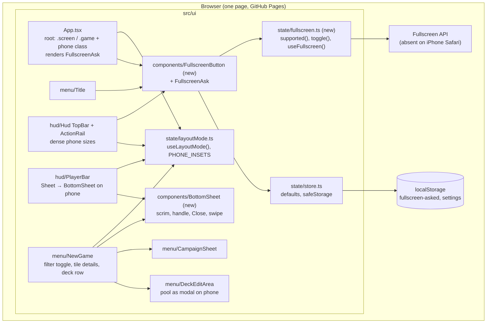

## Context

The phone layout exists (ADR-0005): `useLayoutMode()` in `src/ui/state/layoutMode.ts` says `phone` under 500 px tall or 900 px wide in landscape, the root carries `.game.phone`, and the HUD already splits into a 36 px top bar, left and right drawers (`src/ui/hud/Drawer`), a bottom hand drawer and the play strip column. The menus (`src/ui/menu/*`) do not read the mode: the title, wizard and settings are "phone-first, every control at least 44 px" through plain CSS in `styles.css` (`.screen.wizard`, `.wz-head`, `.wz-foot`, `.wz-chips`) and `NewGame.module.css`, which fits a portrait phone but not a landscape one 393 px tall. The investigator sheet in `PlayerBar.tsx` is a `position: fixed` 420 px popover placed under the avatar's rect; at 393 px of height its lower half is off screen. Nothing in the app touches the Fullscreen API. The store defaults `drawByHand: true` and `tapDecks: true` in three places in `store.ts` (initial state, new-game setup, save restore).

In-force ADRs read for this design (none superseded; all listed in `adr/`): 0002 presentation follows the animation clock, 0004 viewing is view state, 0005 one layout mode read by components, 0016 components own their styles in CSS Modules. ADR-0005 and ADR-0016 constrain this change most: no per-component media queries, phone rules under `.game.phone` or read from the hook, styles in the component's module except the shared primitives.

## Goals / Non-Goals

**Goals:**

- Every screen reachable on a 852×393 phone (title, wizard, settings, table, investigator sheet) fits without an element off screen, with controls that stay tappable (44 px) but take less room.
- One tap puts the app fullscreen where the platform allows it; the player is asked once.
- The two table defaults match what a phone player wants (nothing to tap for a draw).

**Non-Goals:**

- Portrait play (the rotate card stays), a tablet layout, or changing the breakpoint.
- A redesign of the desktop screens; the desktop keeps every size it has.
- A PWA manifest or service worker (the Add to Home Screen hint only points at the browser's own feature).
- Touch gestures beyond the bottom sheet's swipe down.

## Decisions

### D1. The menus read the layout mode through a root class, not the hook per component

`App.tsx` adds `phone` to the `.screen` root the way `Hud` adds it to `.game` (one `useLayoutMode()` read at the root). Menu CSS hangs phone rules off `.screen.phone` (ADR-0005's pattern, extended from the table to the screens). Only components that compute pixels or switch structure (NewGame's filter toggle, the deck step's row, PlayerBar's sheet host) call the hook themselves.

Alternatives: media queries in the menu modules (rejected by ADR-0005); a separate phone wizard component (rejected: the steps and state are identical, only the shape differs).

### D2. One `BottomSheet` component, used by three callers

`src/ui/components/BottomSheet/` renders a scrim and a panel into `document.body` through a portal: `height: 70dvh`, a drag handle, a head with the title and Close, a scrolling body. Open state is the caller's (view state per ADR-0004): PlayerBar's existing `open` state, NewGame's existing `sheet` state. Swipe down uses pointer events on the handle (the same `EDGE_ZONE`-style threshold logic as `Drawer`, 60 px), closes on scrim tap and Escape. Desktop callers keep their current rendering: PlayerBar branches on the mode (`phone ? <BottomSheet> : <popover>`); NewGame renders the sidebar on the desktop and a details control on each tile on the phone.

Alternatives: reuse `Drawer` with `edge="bottom"` (rejected: `Drawer` is bound to `useView().drawer`, which is HUD-only state the wizard doesn't have, and its handle lives on the screen edge, not on the panel); the existing full-screen `dialog.modal` rule (rejected by the user in favour of a bottom sheet). The hand drawer is not a sheet: it is the fan, with no scrim.

### D3. Fullscreen is a small helper plus one button component

`src/ui/state/fullscreen.ts`: `fullscreenSupported()` (checks `document.fullscreenEnabled` and `requestFullscreen` / `webkitRequestFullscreen` on an element), `toggleFullscreen(el)`, `useFullscreen()` (a `useSyncExternalStore` on `fullscreenchange`, mirroring `useLayout`). `src/ui/components/FullscreenButton/` is an icon button shown only when supported, placed by `Title` (top-right) and by `TopBar` on the phone (after the chaos bag). The target element is `document.documentElement`, so the title, wizard and table are all covered by one request and the state survives screen changes.

The one-time ask is a tiny `FullscreenAsk` next to the button component: shown when `layoutMode === "phone"` and `safeStorage().get("fullscreen-asked")` is empty; Enter calls the toggle (inside the tap handler, as the API requires a user gesture) and both answers write the key. Where unsupported it renders the Add to Home Screen line instead. Rendered by `App.tsx` above the screen so it is one place, not per screen.

Alternatives: a settings switch (rejected: the API needs a gesture each time, a switch can't restore it on load); a PWA manifest for standalone mode (deferred, see Open Questions).

### D4. Density by tokens under `.game.phone` / `.screen.phone`, not by new components

Phone sizes are CSS: `--tap: 44px` stays the min-height; labels drop to 13 to 14 px; icon-only buttons get `aria-label` and keep their text for the desktop through the existing `Icon` components. The instruction bar on the phone: `font: 15px/1.2`, `padding: 2px 8px`, caps scaled by `height: 100%`, `margin-inline: 0`; `PHONE_INSETS.bottom` drops from 136 to about 112 px so the camera frames the extra map (`layoutMode.ts`, one constant, with its test). The title menu on the phone: `.screen.phone.title h1` at 44 px, buttons 44 px / 16 px, 6 px gaps.

Alternative: shrink the hit area (rejected by the user; 44 px stays).

### D5. The wizard's phone shape

- Head: `.screen.phone .wz-head` is one 40 px row (`h1` 20 px, dots inline right); `.wz-hint` hidden.
- Filters: NewGame keeps the filter row but on the phone wraps it in a disclosure: a "Filter (n)" chip toggles a local `filtersOpen` state; `n` counts filters set (not "all"). The row renders in place above the grid, so the search field is in the scrolling body and the browser scrolls it into view when focused.
- Footer: `.wz-foot` becomes `position: sticky; bottom: 0` at 48 px with `padding-bottom: env(safe-area-inset-bottom)`.
- Tiles: `grid-template-columns: repeat(3, 1fr)` on the phone.
- Details: on the phone `CampaignStep` and `InvestigatorsStep` render no sidebar; each tile gets a small details control (an `i` icon button, 44 px) that sets the existing `sheet` state, rendered into a `BottomSheet` holding the same `CampaignSheet` or investigator card content. A tap on the tile itself keeps selecting.
- Decks: `DecksStep` on the phone puts the avatars and `deckTabs` in one `overflow-x: auto` row with `scroll-snap`; `DeckEditArea`'s pool opens through the existing card modal pattern (`dialog.modal` takes the phone screen already) instead of inline.

### D6. Defaults

`drawByHand` and `tapDecks` initial values become `false` in `store.ts` initial state and in the save-restore fallback (`save.settings?.x ?? false`); the new-game setup's `tapDecks: true` stays as it is (the engine always asks, the setting decides who answers; see the Tap decks requirement). Saves that hold the keys keep them.

### Component view (C4-inspired, lightweight; Mermaid)

- Boundary: everything is inside the one page; the only external interface is the browser's Fullscreen API and local storage. No engine, content or network change.
- `layoutMode.ts` stays the single switch; the new pieces read it, none adds a media query.
- `BottomSheet` and `FullscreenButton` are the only new shared components; both are presentational and hold no game state.
- Assumption: `safeStorage()` from `state/store.ts` is the right place for the "asked" flag (it already wraps local storage for the tips).

## Risks / Trade-offs

- [iPhone Safari never goes fullscreen] -> the button hides itself and the ask becomes the Home Screen hint; the layout must be good without it, which the density work covers.
- [Fullscreen request refused (no gesture, iframe, policy)] -> `toggleFullscreen` catches the rejection and the button stays in the enter state; no retry loop.
- [Smaller `PHONE_INSETS.bottom` moves the camera] -> one constant with a test; the playwright drive at 852×393 checks a location stays framed above the bar.
- [Density under 44 px by mistake] -> a vitest over the phone CSS rules is impractical; the drive screenshots at 852×393 and the `web-design-guidelines` review before archive are the check.
- [Bottom sheet's swipe fights the body's scroll] -> the swipe listens on the handle only; the body scrolls normally.
- [Changed defaults surprise returning players] -> only fresh devices and saves without the keys are affected; the settings screen still shows both switches with hints.

## Migration Plan

Ship with the normal deploy. No data migration: saves carry their settings; the "fullscreen-asked" key is new and absent means "ask". Rollback is a revert; the stored key is harmless to older builds.

## Open Questions

- Whether to add a PWA manifest later so the Home Screen hint leads to a true standalone window (a separate change; `web-deployment` spec).
- Whether the deck step's full-screen pool should become the shared `BottomSheet` as well once it exists; the modal is kept here because the pool needs the whole height.
- No in-force ADR needs supersession; D1 is an application of ADR-0005 to the menus, not a change to it.
